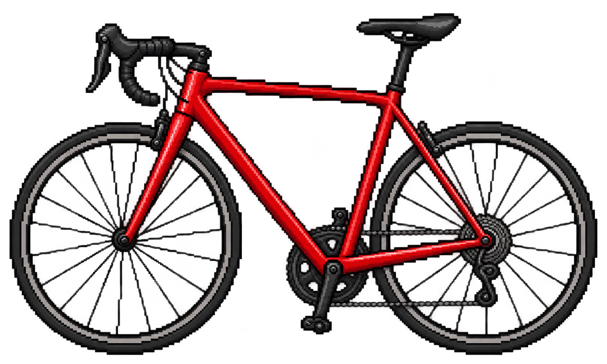

<table>
  <tr>
    <td width="360" rowspan="2" align="center" valign="middle">
      
    </td>
    <td width="440" valign="top">
      <h1>feuersteiner</h1>
      
hi, you can call me "feuersteiner". I'm your friendly neighborhood engineer.

      
I love building useful things. I love making tech disappear. when not building you can find me cycling.

      
<a href="https://flintworks.dev">Writing &amp; experiments ↗</a>

    </td>
  </tr>
  <tr>
    <td align="center" valign="bottom">
      
    </td>
  </tr>
</table>

## Philosophy

<h3>Craft</h3>

We care about what we create. We explore the alternatives, weigh the tradeoffs, and make decisions with judgment built over a career. We want the work to hold up, down to the details.

<h3>Accountability</h3>

We care about what we create, and we own the engineering decisions behind it. “It’s not me, it’s the agent” doesn’t cut it. We care about what users actually go through. We put our best engineering effort, including how we use AI, into building software people can rely on—and we take failures seriously.

<h3>Enablement</h3>

We want what we create to let you do more. You should be able to build your organization on solid foundations. We believe open source is the best way to make that possible: software you can understand, change, and build on independently.

